# Télécommande Infrarouge Autonome pour Vidéoprojecteurs (Projet 32)


Conception matérielle (prototypage sur Arduino Uno puis PCB sur mesure sous KiCad 9), rétro-ingénierie de protocole infrarouge (standard NEC 38 kHz) et développement logiciel embarqué (MicroPython & C++) d'un boîtier autonome destiné à éteindre automatiquement les vidéoprojecteurs de la salle des conseils de **Grenoble INP - Phelma** lorsqu'elle est inoccupée. Ce système prévient l'usure prématurée des lampes (estimée à 1 250 h/an d'allumage inutile, soit 33 % de leur durée de vie) et réduit la consommation énergétique du bâtiment.

* **[Consulter le rapport technique du projet (PDF)](docs/project_report.pdf)**
* **[Consulter le support de soutenance technique (PDF)](docs/presentation_slides.pdf)**
* **[Consulter le schéma électrique du prototype initial (PDF)](docs/arduino_prototype_schematic.pdf)**
* **[Voir la vidéo de démonstration du prototype en salle des conseils](assets/autonomous_remote_demo.mp4?raw=true)**

---

## Sommaire
1. [Aperçu matériel : du prototype au produit final](#aperçu-matériel--du-prototype-au-produit-final)
2. [Contexte et cahier des charges (SysML)](#contexte-et-cahier-des-charges-sysml)
3. [Architecture matérielle et carte PCB (KiCad 9)](#architecture-matérielle-et-carte-pcb-kicad-9)
4. [Rétro-ingénierie du protocole NEC et firmware embarqué](#rétro-ingénierie-du-protocole-nec-et-firmware-embarqué)
5. [Conception mécanique et intégration du boîtier](#conception-mécanique-et-intégration-du-boîtier)
6. [Structure du dépôt](#structure-du-dépôt)
7. [Auteurs et encadrement](#auteurs-et-encadrement)

---

## Aperçu matériel : du prototype au produit final

| Phase 1 : Prototypage sur breadboard (Arduino Uno) | Phase 2 : Conception PCB sur mesure (KiCad 9 — v1.2) |
| :---: | :---: |
| 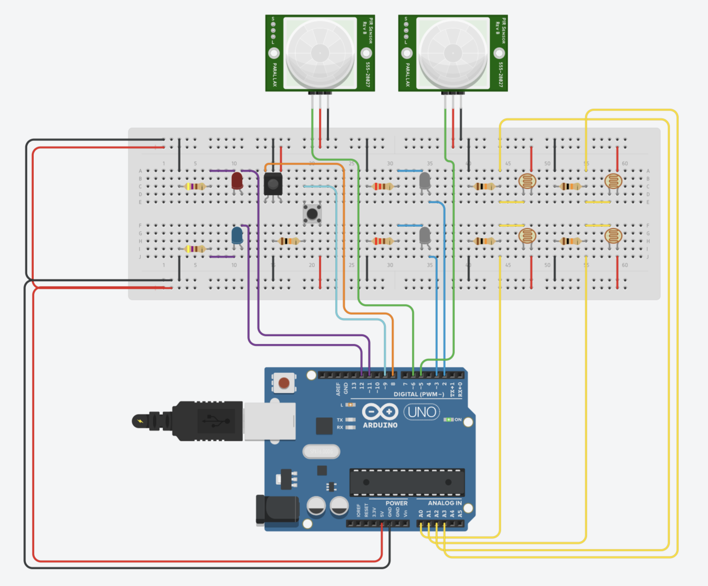 | 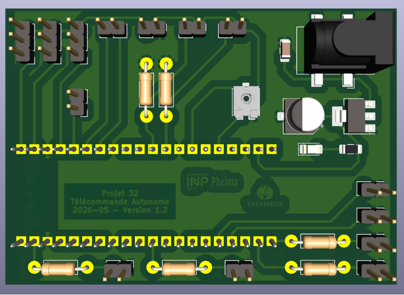 |
| *Câblage initial sur plaque d'essai : Arduino Uno, 2 capteurs PIR, 4 LDR (`A0`–`A3`), récepteur et LED IR* | *Carte finale double face accueillant le Raspberry Pi Pico 2WH, l'étage LDO 5V et les connecteurs dédiés* |

| Assemblage et soudure au laboratoire | Câblage interne dans le boîtier | Prototype final assemblé et testé |
| :---: | :---: | :---: |
| 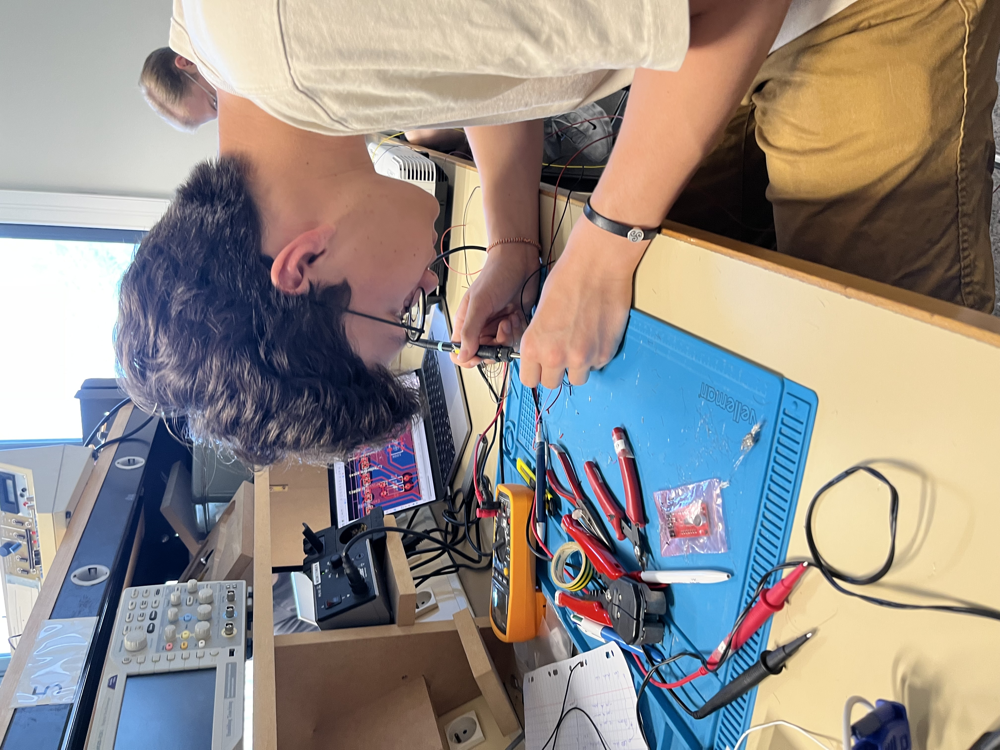 | 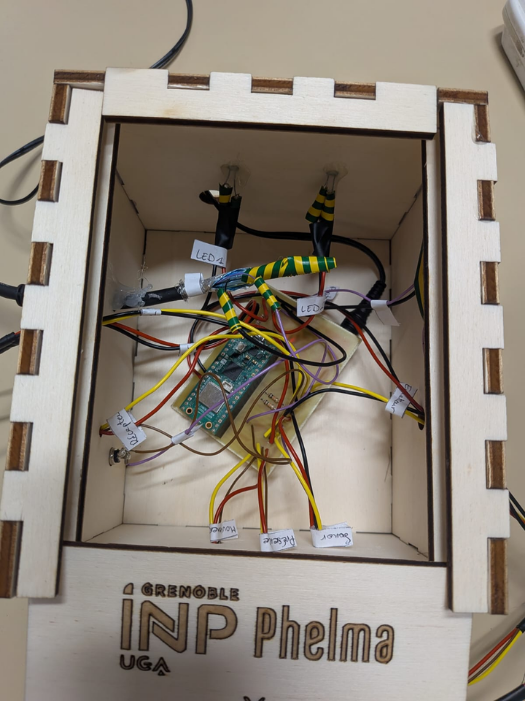 | 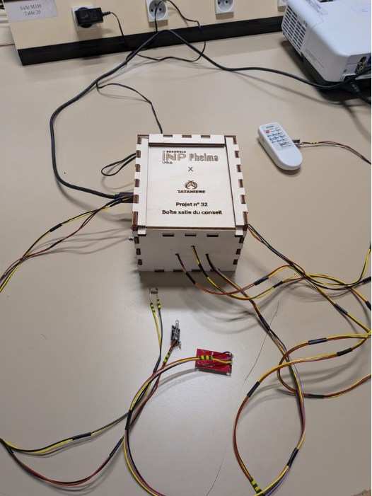 |

---

## Contexte et cahier des charges (SysML)

À l'issue des réunions en salle des conseils, les vidéoprojecteurs restent fréquemment allumés toute la nuit (environ 2 fois par semaine, soit $1\,250\text{ h/an}$ sur une durée de vie totale de lampe de $3\,000$ à $4\,000\text{ h}$). Le système conçu répond à trois niveaux d'exigences fonctionnelles :
1. **Détection de l'état réel des vidéoprojecteurs :** Mesure directe de la tension sur les sorties **VGA** (`VGA1`, `VGA2`) couplée à des photorésistances (`PGM1201`) afin de ne commander l'extinction que si l'appareil ciblé est effectivement sous tension.
2. **Surveillance multi-capteurs de l'occupation :** Fusion des informations issues d'un capteur de mouvement infrarouge passif (`SBC-PIR`), d'un radar de présence à ondes millimétriques (`mmWave Gravity SEN0609`) et d'un détecteur acoustique (`SEN-14262`).
3. **Extinction automatique et mode *Sniffer* d'apprentissage :** Émission d'une salve infrarouge d'extinction après $1\text{h}30$ ($5\,400\text{ s}$) d'inactivité ou en cas de surchauffe/luminosité excessive, et possibilité de cloner à la volée une nouvelle télécommande par simple appui long (3 secondes) sur le bouton d'apprentissage (`GPIO19`).

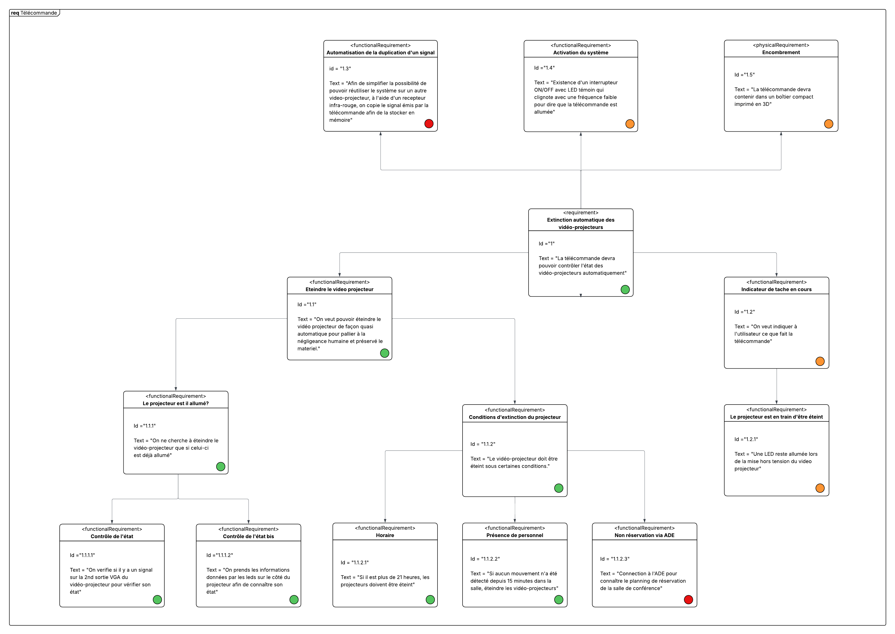

---

## Architecture matérielle et carte PCB (KiCad 9)


### Brochage de la carte électronique (Version 1.2)

La carte électronique double face ($135 \times 130\text{ mm}$) intègre un étage de régulation linéaire **5V** (`TLV1117-50` alimenté en 12V DC via `J1`) et centralise l'ensemble des capteurs et actionneurs autour du microcontrôleur **Raspberry Pi Pico 2WH** :

| Connecteur PCB | Signal / Label | Broche MCU | Rôle fonctionnel |
|---|---|---|---|
| **`J_VGA1` / `J_VGA2`** | `VGA1` / `VGA2` | `GPIO3` / `GPIO2` | Lecture de l'état sous tension des vidéoprojecteurs 1 et 2 via leurs ports VGA. |
| **`J_Photoresistance1/2`** | `ADC0` / `ADC1` | `GPIO26` / `GPIO27` | Mesure analogique de luminosité (`PGM1201`) avec pont diviseur $10\text{ k}\Omega$ (`R5`, `R6`). |
| **`RV1`** | `ADC2` | `GPIO28` | Potentiomètre CMS Vishay `TS53YL` ($100\text{ k}\Omega$) d'ajustement dynamique du seuil. |
| **`J_DETECTEUR_MOUVEMENT1`** | `SIG` | `GPIO16` | Entrée numérique du capteur de mouvement infrarouge passif (`SBC-PIR`). |
| **`J_DETECTEUR_PRESENCE1`** | `VOUT` | `GPIO17` | Entrée numérique du capteur de présence radar mmWave (`SEN0609`). |
| **`J_CAPTEUR_SONORE1/2`** | `ENVELOPE` / `GATE` | `GPIO20` / `GPIO21` | Acquisition de l'enveloppe acoustique et du seuil binaire (`SEN-14262`). |
| **`J_EMETTEUR1` / `2`** | `EMETTEUR1` / `2` | `GPIO7` / `GPIO14` | Commande PWM 38 kHz des 2 émetteurs IR (`GT1087`) via résistances $220\ \Omega$ (`R3`, `R4`). |
| **`J_RECEPTEUR1`** | `S_OUT` | `GPIO18` | Réception et apprentissage (*Sniffer*) de trames infrarouges externes (`GT1089`). |
| **`J_Bouton1`** | `BOUTON` | `GPIO19` | Bouton poussoir (`R1381R`, `PULL_UP`) activant le mode apprentissage après 3 s d'appui. |
| **`J_LED1` / `J_LED2`** | `Net-(GPIO0/1)` | `GPIO0` / `GPIO1` | LED témoins en façade (Présence détectée sur `GPIO0`, Projecteur allumé sur `GPIO1`). |

### Nomenclature matérielle (BOM)

| Composant | Référence | Quantité | Fonction |
|---|---|---|---|
| Microcontrôleur | `Raspberry Pi Pico 2WH` (`SC1634`) | 1 | Unité centrale de traitement, PWM 38 kHz et machine d'état |
| Régulateur LDO 5V | `TLV1117-50` (SOT-223) | 1 | Régulation 12V → 5V (`VCC`) avec condensateurs CMS $10\ \mu\text{F}$ (`C1`, `C2`) |
| Détecteur sonore | `SEN-14262` | 1 | Surveillance de l'activité sonore dans la salle des conseils |
| Radar de présence | `mmWave Gravity SEN0609` | 1 | Détection fine de présence humaine statique ou en mouvement |
| Capteur PIR | `SBC-PIR` | 1 | Détection de mouvement thermique dans la salle |
| Photorésistances | `PGM1201` | 4 | Détection optique complémentaire et sécurité de surchauffe |
| Émetteurs IR | `GT1087` | 2 | Émission directionnelle des trames d'extinction à 38 kHz |
| Récepteur IR | `GT1089` | 1 | Capture et clonage du signal de la télécommande d'origine |
| Bouton poussoir | `R1381R` | 1 | Déclenchement manuel du mode d'apprentissage infrarouge |

---

## Rétro-ingénierie du protocole NEC et firmware embarqué

### 1. Identification et décodage de la trame à l'oscilloscope
Le signal émis par la télécommande d'origine face au récepteur `GT1089` a été capturé à l'oscilloscope numérique **Tektronix** et décodé via un banc Arduino Uno (`firmware/arduino_ir_receiver`), révélant une modulation **NEC** sur porteuse à **38 kHz** de valeur hexadécimale brute **`0x6F905583`** (soit les 4 octets `0x83`, `0x55`, `0x90`, `0x6F` transmis LSB-first) :

* **En-tête de synchronisation (AGC Burst) :** Impulsion modulée de $9\text{ ms}$ (`mark(9000)`) suivie d'un silence de $4,5\text{ ms}$ (`space(4500)`).
* **Bit logique `0` :** Impulsion de $562\ \mu\text{s}$ suivie d'un silence de $562\ \mu\text{s}$ (durée totale : $1,125\text{ ms}$).
* **Bit logique `1` :** Impulsion de $562\ \mu\text{s}$ suivie d'un silence long de $1,675\ \text{ms}$ (durée totale : $2,25\text{ ms}$).

| Principe temporel du protocole NEC | Capture de la trame IR à l'oscilloscope Tektronix |
| :---: | :---: |
| 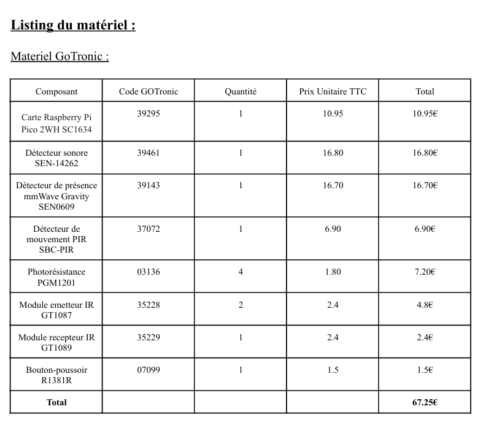 | 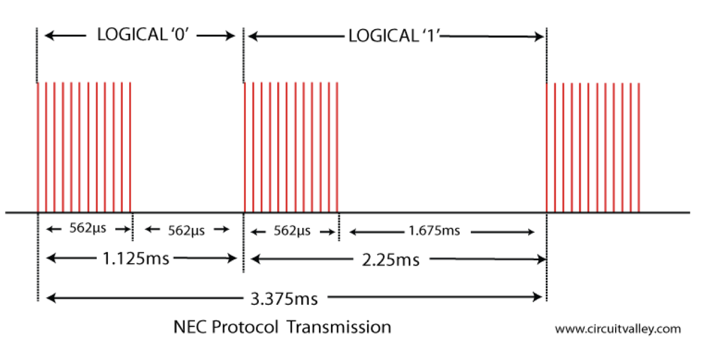 |

### 2. Synthèse PWM 38 kHz et mode *Sniffer* sous MicroPython (`firmware/pico_main/main.py`)
Le firmware principal embarqué sur le **Raspberry Pi Pico 2WH** pilote simultanément les deux émetteurs IR (`GPIO7` et `GPIO14`) via les générateurs PWM matériels cadencés à $38\text{ kHz}$ (rapport cyclique de 50 %, `duty_u16(32768)`) :
* **Triple tir d'extinction (`envoyer_code_nec_universel()`) :** Envoie 3 trames NEC consécutives espacées de $500\text{ ms}$ pour garantir la prise en compte de l'extinction (y compris sur les projecteurs exigeant une double confirmation).
* **Mode d'apprentissage universel (`lancer_mode_apprentissage()`) :** Un appui de plus de 3 secondes sur le bouton `GPIO19` place le boîtier en écoute sur le récepteur `GT1089` (`GPIO18`), mesure à la microseconde les 67 fronts successifs (`time.ticks_us()`), discrimine les bits `1` ($> 1\,200\ \mu\text{s}$) et `0`, et met à jour dynamiquement en mémoire les 4 octets `NEC_B1` à `NEC_B4`.

---

## Conception mécanique et intégration du boîtier

Pour protéger la carte électronique de la poussière dans le faux plafond tout en intégrant les passages de câbles et l'interface utilisateur :
1. **Modélisation 3D initiale (CAO 3D) :** Conception d'un boîtier perforé et de son couvercle à poignée.
2. **Boîtier en bois découpé au laser (solution retenue) :** Conception d'un boîtier assemblé à créneaux ($14 \times 15,5 \times 10\text{ cm}$) généré via `boxes.py`, adapté en CAO 2D pour les perçages des connecteurs et fabriqué au FabLab de Phelma.

| Modélisation 3D de la base | Modélisation 3D du couvercle | Plan 2D de découpe laser (`boxes.py`) |
| :---: | :---: | :---: |
| 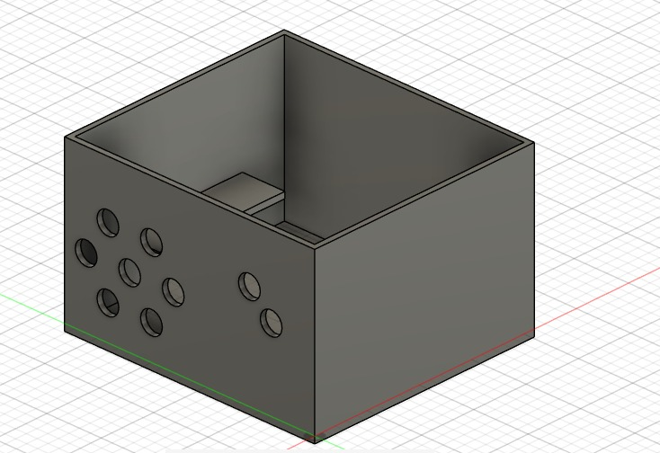 | 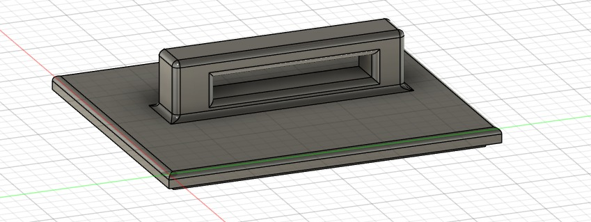 | 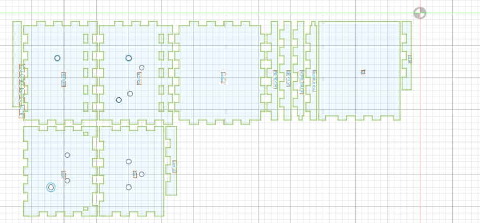 |

| Démonstration lors de la soutenance finale |
| :---: |
| 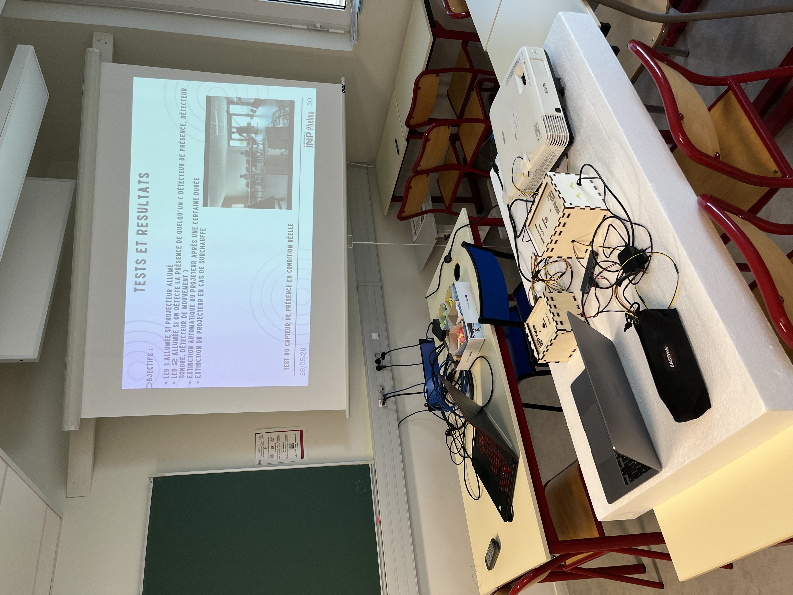 |

---

## Structure du dépôt

```text
autonomous-ir-projector-remote/
├── .gitattributes                            # Détection KiCad / Python / C++ par GitHub Linguist
├── .gitignore
├── README.md
├── assets/
│   ├── arduino_breadboard_prototype.png      # Câblage du prototype initial sur breadboard (Tinkercad)
│   ├── autonomous_remote_demo.mp4            # Vidéo de test d'extinction automatique en salle
│   ├── enclosure_3d_base.jpg                 # Modélisation CAO 3D du boîtier
│   ├── enclosure_3d_lid.jpg                  # Modélisation CAO 3D du couvercle
│   ├── ir_frame_oscilloscope.png             # Acquisition Tektronix de la trame NEC 32 bits
│   ├── laser_cut_layout.jpg                  # Mise à plat 2D pour découpe laser
│   ├── nec_protocol_timing.png               # Chronogramme du protocole NEC
│   ├── pcb_3d_render.png                     # Rendu 3D de la carte PCB sous KiCad 9 (v1.2)
│   ├── pcb_soldering_bench.jpg               # Assemblage et soudure de la carte au laboratoire
│   ├── project_defense_setup.jpg             # Démonstration lors de la soutenance
│   ├── prototype_assembled_box.png           # Boîtier final assemblé et câblé
│   ├── prototype_inside_wiring.png           # Vue intérieure du câblage (Raspberry Pi Pico 2WH)
│   ├── sysml_requirements_diagram.png        # Diagramme des exigences SysML
│   └── system_architecture.svg               # Schéma synoptique vectoriel de l'architecture
├── docs/
│   ├── arduino_prototype_schematic.pdf       # Premier schéma électrique sur Arduino Uno
│   ├── bom_components.csv                    # Nomenclature initiale des composants (CSV)
│   ├── presentation_slides.pdf               # Support de soutenance technique
│   └── project_report.pdf                    # Rapport technique du projet (Grenoble INP - Phelma)
├── firmware/
│   ├── arduino_ir_receiver/
│   │   └── arduino_ir_receiver.ino           # Capture et décodage hexadécimal de la trame NEC
│   ├── arduino_ir_sender/
│   │   └── arduino_ir_sender.ino             # Test d'émission du code 0x6F905583 sous Arduino
│   └── pico_main/
│       └── main.py                           # Firmware complet MicroPython (capteurs, NEC, Sniffer)
└── hardware_kicad/
    ├── BE-Elec-Projet-Type-Kicad.kicad_pro   # Projet KiCad 9.0
    ├── BE-Elec-Projet-Type-Kicad.kicad_sch   # Schéma électrique complet
    └── BE-Elec-Projet-Type-Kicad.kicad_pcb   # Routage PCB double face (Version 1.2)
```

---

## Auteurs et encadrement

Projet réalisé à **Grenoble INP - Phelma** (Année universitaire 2025–2026 — Projet n°32) :
* **Équipe Partie II (Télécommande autonome) :** Aurélien Capron (Chef de projet), Amaury Simonnot, Corentin Pilleux, Corentin Eletti, Reda Lounis.
* **Équipe Partie I (Interface PWM / S.Bus) :** Martin Fleury, Mathis Menager, Jules Ancel, Simon Danquigny.
* **Encadrement :** Julien Traveaux, Sophie Cornu et l'équipe du FabLab de Grenoble INP - Phelma.